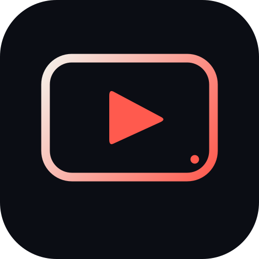
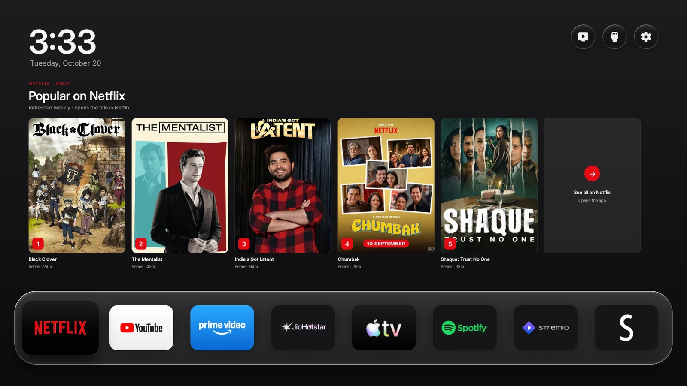
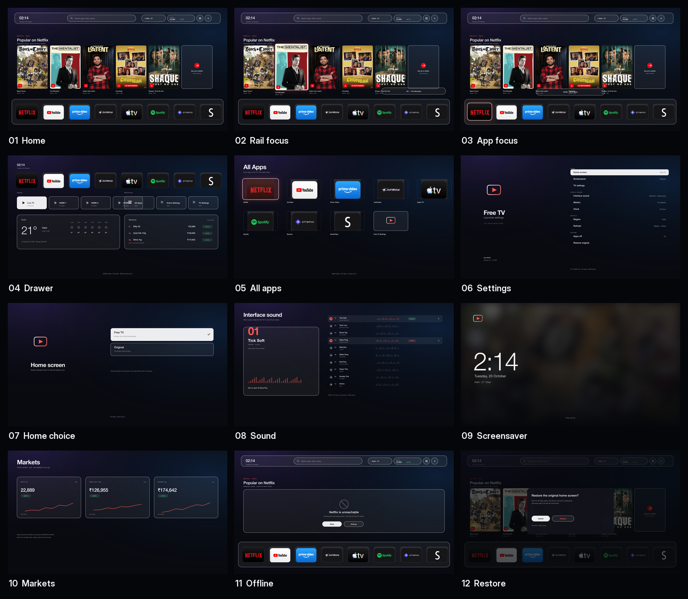
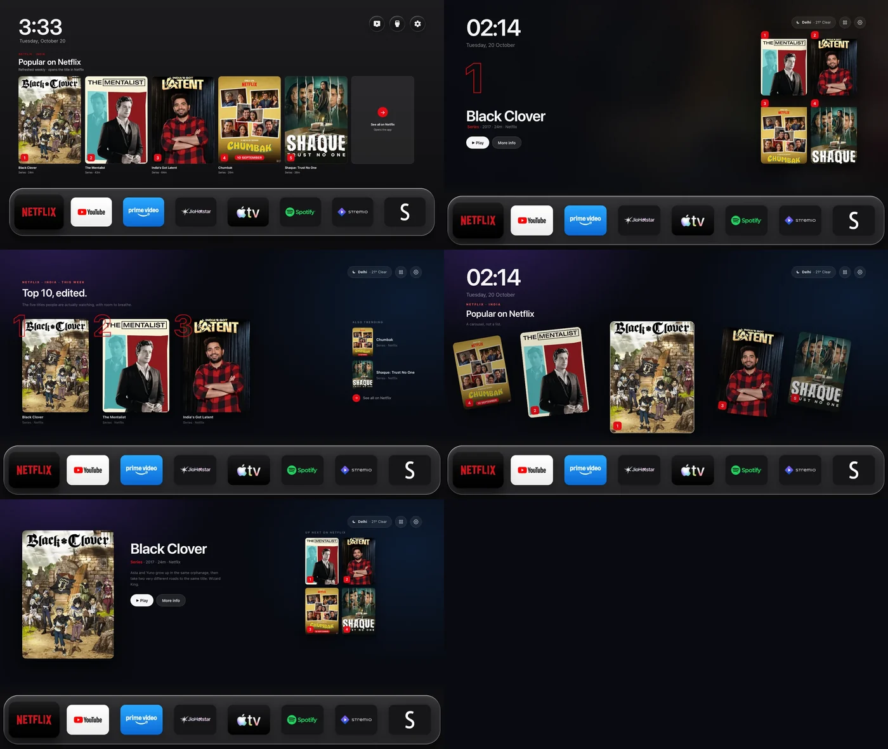
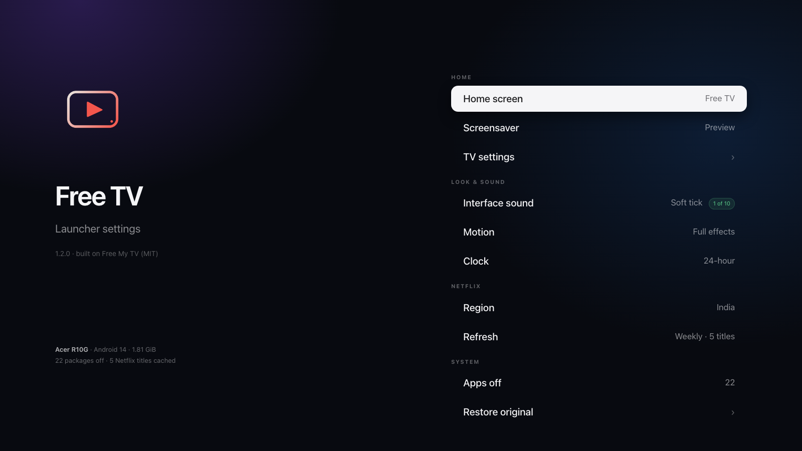

<div align="center">



# Free TV

**A calm, ad-free home screen for Android TV and Google TV.**

A cinematic clock, the weather, a real **Popular on Netflix** rail, and the apps you actually use.<br>
No root. One button back to the factory home screen.

[](https://www.android.com/tv/)
[](LICENSE)
[](https://github.com/simbasjungles/free-my-tv)



</div>

## Why

The stock launcher is a shop window: sponsored rows, promos, and a recommendation feed you did not ask for. Free TV replaces it with a quiet screen — time, weather, one useful Netflix rail, your apps — and puts everything back with one switch.

It is built on **[Free My TV](https://github.com/simbasjungles/free-my-tv)** by Simba (MIT). The Acer R10G / Realtek profile, the Netflix rail, the retention fix and the sound lab are ours; the original design and the safety model are his. See [NOTICE](NOTICE) and [CREDITS](CREDITS.md).

## What you get

- **Popular on Netflix — no account, no API key.** Five titles for India, refreshed weekly, each opening its Netflix page. Popularity data from JustWatch; not a personal recommendation. [Why](#the-netflix-rail).
- **A clock that is actually a clock.** Time, date, and the weather, in the same visual language as the shelf.
- **Your shelf, not theirs.** Netflix, YouTube, Prime Video, JioHotstar, Apple TV, Spotify, Stremio and SmartTube on the Acer build; edit one array for your TV.
- **A drawer that earns its place.** Live TV, HDMI inputs, All Apps, Home Settings, TV Settings, the full weather and crypto cards.
- **No ads, no analytics, no accounts.** Three permissions: internet, network state, boot completed. No tracking SDK, no library, no Gradle.
- **One button back.** *Original* restores the factory home screen, screensaver and every app it turned off, without uninstalling anything.
- **Two quiet sounds, chosen.** 01 Tick Soft on focus and 04 Glass Ping on open; the other eight live in [`sound-lab/`](sound-lab) for a future picker.

## Measured, not claimed

Same TV, same boot, Acer R10G (1.81 GiB RAM, Android 14, 1920×1080):

| | Stock Google TV | Free TV (fresh) | Free TV after use |
|---|---|---|---|
| Home PSS | 151 MB | **129 MB** | 106 MB |
| Graphics | 40 MB | 77 MB | 64 MB |
| Frame p50 | 17 ms | 18 ms | — |
| Packages off | 5 | **22** | 22 |

These P2 figures predate the larger 1.2 rail; P4 re-measures. The before/after of the settings retention: opening Settings used to add **+9 MB of graphics per open** (101 → 191 MB over ten opens). Settings now runs in its own `:settings` process, releases its `Scene` bitmaps on exit, and ends that process; the home stays at **77 MB graphics fresh, 64 MB after ten opens** — no growth. Full method and caveats: [`FORK.md`](FORK.md).

> The home is already fast. The real constraint is 1.8 GB RAM and zram churn, not the launcher. We do not promise a faster CPU.

## Install

**You need:** JDK 17+ (21 works), Android SDK build-tools **36.0.0**, platform **android-34**, and `adb`. Build-tools 34's `d8` crashes on the anonymous-class `MethodParameters` that javac 21 emits; 36 fixes it.

```bash
git clone https://github.com/Ghost-9/free-tv
cd free-my-tv
cp config.example.properties config.properties   # city, country, currency
./build.sh
adb connect <TV-IP>:5555
adb install -r FreeMyTV.apk
```

On the TV: open **Free TV → Home Screen → Free TV**, and accept *Allow USB debugging* once (tick *Always allow*). The app uses the TV's own loopback ADB and runs fixed commands only; it never listens on the network.

**Going back:** *Home Screen → Original*. The factory launcher, screensaver and apps return. If the home screen crashes three times in five minutes, the watchdog switches back by itself.

## The Netflix rail

Netflix does not expose per-profile recommendations to third-party apps, and the TV exposes no Watch Next rows to `shell`. The rail therefore uses **JustWatch's public popularity graph** for `Netflix India`:

- keyless GraphQL, no account;
- real posters, five titles, weekly cache;
- each card carries the provider's `netflix.com/title/<id>` link and is handed to the Netflix app;
- labelled **Popular on Netflix**, never "For You".

If Netflix or JustWatch changes the endpoint, the rail falls back to its last cache and then to a quiet message; the rest of the home screen is unaffected.

## FigCraft UI kit



Twelve screens and states — home, rail focus, app focus, drawer, all apps, settings, home choice, sound
picker, screensaver, markets, offline and restore — plus five homepage directions and five app-rail
designs. All in three FigCraft-importable SVGs with named layers and embedded art:
[`docs/design/`](docs/design/).

## Design directions



1. **Big Rail** (shipped) — five 270×378 posters, focus glow, See all, shelf. The balance of size and density.
2. **Hero Grid** — one title on the left, a 2×2 grid on the right. Best for a single strong pick.
3. **Editorial Top 10** — three large posters, oversized ranks, a short side list. The most magazine-like.
4. **Cover Flow** — a real carousel with depth; the most dynamic, the most GPU.
5. **Stage** — focused poster + synopsis + Play, with an Up Next grid. The most informative.

Full-size files and tradeoffs: [`docs/designs/`](docs/designs/).

## Settings direction



The agreed direction: one calm list, no dead rows. **Home**, **Screensaver**, **TV settings**; **Interface sound** (one of the ten in `sound-lab/`, off until chosen), **Motion** (full/reduced), **Clock**; **Netflix region/refresh**; **Apps off** and **Restore original**. The current build already ships Home, Screensaver, TV settings, the Netflix rail status and the comparison; the remaining rows are P3.

## Build your own

| What | Where |
|---|---|
| Apps to turn off | `HomeMode.DEBLOAT` |
| Apps never to touch | `HomeMode.PROTECTED` |
| Shelf / Live TV / hidden apps | `HomeApps.SHELF`, `LIVE_TV_APPS`, `HIDDEN` |
| Netflix rail | `NetflixRail.java` |
| Sounds | `sound-lab/` (10 WAVs, 48 kHz) |

The Acer profile is a starting point, not a generic debloat list. **Never run a generic Android TV package list** against a TV: `com.amazon.firebat` is Prime Video, `com.mediatek.tv.oneworld.tvcenter` is the HDMI switcher, and Widevine breaks when you guess.

## Roadmap

- [x] Acer R10G profile, shelf, Live TV, 22 packages off
- [x] Keyless Netflix rail, direct title links
- [x] Settings/`Scene` retention fix
- [x] Free TV branding, licence and credit
- [ ] Sound picker + motion/effects setting
- [ ] Background freeze A/B, TV Standby A/B
- [ ] `tvbench` measurement harness, cold launch + boot baseline
- [ ] Package rename (`io.freemytv` → `app.freetv.launcher`) for release builds

## Credit & licence

Free TV is a derivative of **Free My TV** © 2026 Free My TV contributors, MIT.
Free TV changes © 2026 Mayank Batra / Avartana Labs, MIT.

Data: JustWatch (popularity), Netflix (title links, posters fetched at runtime), Open-Meteo (weather), Binance (prices).
Type: Inter (SIL OFL 1.1). Icons: Material Symbols (Apache 2.0). Coin logos: cryptocurrency-icons (CC0).

Not affiliated with, endorsed by, or sponsored by Netflix, Google, Acer or Realtek. Netflix and Google TV are trademarks of their owners. The MIT licence is in [LICENSE](LICENSE).
